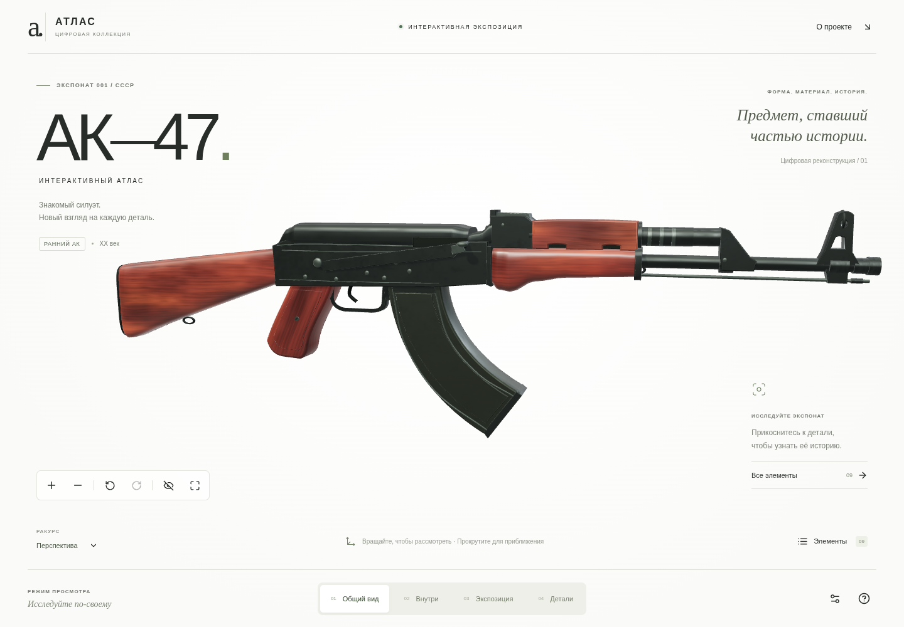

# АК-47 — Интерактивный атлас

Оригинальная интерактивная 3D-экспозиция исторического внешнего образа **раннего АК по двум боковым фотографиям владельца**. Модель создаётся программно в браузере: без скачанных моделей, Blender, фотографий вместо 3D и внешних текстур.

> Это художественная музейная реконструкция, а не точная копия конкретного экземпляра. Музейные сайты оказались недоступны из среды разработки; полноценное визуальное исследование по фотографиям не выполнено. Подробности — в [источниках](docs/REFERENCES.md) и [ограничениях](docs/LIMITATIONS.md).



## Что работает

- Настоящая WebGL2-сцена с оригинальной процедурной геометрией: клиновидный приклад, наклонная рукоятка, плоские боковины корпуса с заклёпками, прорези у верхней накладки, гладкий изогнутый магазин и уточнённая передняя группа.
- Красно-коричневое дерево с генерируемыми волокнами и неоднородным лаком; тёмное неоднородное PBR-покрытие металла; студийные отражения, мягкие фаски и самозатенение в высоком качестве.
- Поворот на 360°, приближение, инерция, четыре предустановленных ракурса и возврат камеры.
- Девять выбираемых внешних групп; подсветка, карточки на русском, исторический контекст и пояснения к реконструкции.
- Четыре режима: общий вид, условный внутренний обзор, разнесённая музейная композиция и фокус на детали.
- Плавное разнесение групп с линиями, маркерами и подписями; плавное возвращение целой модели.
- Невесомость и включаемое автовращение, которое приостанавливается при взаимодействии.
- Управление мышью, одним пальцем и жестом масштаба двумя пальцами.
- Отдельная мобильная компоновка: карточка расположена ниже 3D-области и прокручивается внутри; крупный план использует меньше пустых полей на узком экране.
- «Авто», «Низкое», «Среднее», «Высокое» качество; адаптивный pixel ratio.
- Поддержка `prefers-reduced-motion`, клавиатурный список деталей, фокус в диалогах, скрытие интерфейса и полноэкранный режим там, где его поддерживает браузер.
- Объяснение сбоя WebGL и повторный запуск сцены.

Внутренние области показаны абстрактными объёмами. Кинематики, инженерных размеров, боеприпасов и практических инструкций нет. Разнесение — свободная художественная композиция, не порядок разборки.

## Временный предпросмотр

По текущему запросу владельца GitHub Pages не публикуется. Последняя модель доступна в запущенном сервере внутри облачной среды; внешнюю временную HTTPS-ссылку пока получить не удалось. Встроенный доступ к порту не предоставлен, сетевой прокси блокирует сервис туннеля, а установленный Cloudflare-клиент не смог разрешить его адрес через DNS. Внутренний адрес не подходит для открытия с телефона. Подробности и подготовленные настройки — в [docs/TEMPORARY_PREVIEW.md](docs/TEMPORARY_PREVIEW.md).

## Открыть с телефона после разрешения публикации

Публичная HTTPS-публикация — отдельный шаг после сохранения изменений в GitHub. Локальная сборка сама по себе не создаёт публичную ссылку.

Самый короткий путь без слияния веток — **Netlify**:

1. Откройте [app.netlify.com](https://app.netlify.com/) на телефоне, войдите через GitHub.
2. **Add new project → Import an existing project → GitHub → ak47-interactive-atlas**.
3. В **Branch to deploy** выберите **codex/ak47-museum-atlas**, поле **Base directory** оставьте пустым.
4. Настройки сборки уже находятся в `netlify.toml`: команда `npm run build`, папка `dist`, Node.js 24. Нажмите **Deploy project**.
5. После статуса **Published** откройте выданную ссылку `https://…netlify.app`.

Подробные шаги и управление жестами — [инструкция для телефона](docs/PHONE_LAUNCH.md). Это публикация сайта на Netlify; GitHub Pages не используется. Внешняя публикация агентом не выполнена.

Альтернатива через **Vercel** после слияния исходников:

1. Откройте [предложение изменений из ветки реализации](https://github.com/DiRiK25/ak47-interactive-atlas/pull/new/codex/ak47-museum-atlas) и примите её в `main`: **Create pull request → Merge pull request → Confirm merge**. Если интерфейс показывает кнопку **Create PR**, она ведёт к тому же процессу.
2. На телефоне откройте [vercel.com/new](https://vercel.com/new), войдите через GitHub, выберите **Import Git Repository → DiRiK25/ak47-interactive-atlas → Import**. При необходимости разрешите Vercel доступ только к этому репозиторию.
3. Vercel распознает Vite. Проверьте **Build Command: `npm run build`**, **Output Directory: `dist`**, затем нажмите **Deploy**. Переменные и ключи не нужны. После успешного развёртывания **Visit** откроет HTTPS-сайт.

Не требуется компьютер или терминал. Авторизация во внешнем аккаунте выполняется владельцем аккаунта; приложение не хранит её данные.

Ранее для **GitHub Pages без отдельного аккаунта хостинга** подготовлена ветка `codex/static-site`. Она содержит предыдущую сборку; в текущей доработке по фото эта ветка намеренно не обновлялась, чтобы не запускать возможную публикацию. Если Pages доступен для вашего репозитория:

1. Откройте **Settings → Pages**.
2. Выберите **Source: Deploy from a branch**, **Branch: codex/static-site**, папку **/ (root)** и нажмите **Save**.
3. Дождитесь завершения публикации и нажмите **Visit site** на той же странице. Это действие публикует сайт; ветка с исходниками остаётся отдельной.

Ветка `codex/static-site` — снимок проверенной сборки. При последующих изменениях её нужно обновлять новой сборкой. Для автоматизированных будущих публикаций также есть workflow **GitHub Pages** после принятия исходников в `main`:

1. В репозитории: **Settings → Pages → Build and deployment → Source: GitHub Actions**.
2. **Actions → Опубликовать на GitHub Pages → Run workflow → main → Run workflow**.
3. После зелёного результата откройте адрес из задания **deploy**. Workflow запускается вручную; его наличие не означает, что сайт уже опубликован.

## ZIP без терминала

В корне проекта находится готовый [AK47-Interactive-Atlas.zip](AK47-Interactive-Atlas.zip). На странице файла GitHub нажмите **Download raw file** (значок скачивания, иногда внутри меню `…`). На телефоне файл попадёт в загрузки браузера.

Архив содержит исходники, конфигурацию, lockfile, тесты, документацию и собственные снимки приложения. Он не содержит `node_modules`, `.git`, токенов, `.env`, временных кэшей и отчётов тестового запуска.

Workflow **Проверки и ZIP** дополнительно создаёт три скачиваемых артефакта: архив исходников, готовую папку `dist` и браузерный отчёт. Они появятся только после реального успешного запуска GitHub Actions.

## Как пользоваться

| Действие | Компьютер | Телефон |
| --- | --- | --- |
| Повернуть | Перетаскивание мышью | Движение одним пальцем |
| Изменить масштаб | Колесо, кнопки `+`/`−` | Жест двумя пальцами, кнопки `+`/`−` |
| Выбрать деталь | Нажатие на модель или «Элементы» | Касание модели или «Элементы» |
| Крупный план | «Рассмотреть» в карточке | Та же кнопка в нижней карточке |
| Вернуть камеру | Кнопка со стрелкой или `R` | Кнопка со стрелкой |
| Сменить представление | Четыре режима внизу | Четыре режима внизу |
| Вернуть целый предмет | «Вернуть модель» в экспозиции | Та же кнопка |
| Закрыть окно | Крестик или `Esc` | Крестик |

В режиме «Внутри» список содержит три условные области. В остальных — девять наружных элементов. Карточку можно листать стрелками. Исторический контекст и пояснения раскрываются внутри карточки; на телефоне её содержимое прокручивается.

## Технологии

React 19, TypeScript 5.9, Vite 7, Three.js 0.180, OrbitControls, Lucide, CSS. Для проверок — Vitest и Playwright. Сервер, база данных, аккаунты пользователей и API-ключи приложению не нужны.

Прямой Three.js выбран для контроля геометрии, материалов, raycasting, объединения мешей и освобождения GPU-ресурсов. Пояснения — в [архитектуре](docs/ARCHITECTURE.md).

## Запуск для разработчика

Эти команды приведены для воспроизводимости и будущих задач Codex; владельцу телефона запускать их не требуется.

Требования: Node.js 24 (зафиксирован в `.nvmrc`) и npm. Из корня репозитория:

```bash
npm ci
npm run dev
```

Production:

```bash
npm run build
npm run preview
```

Результат — папка **`dist`**. Её размещают на статическом HTTPS-хостинге. Открытие `index.html` через `file://` не является поддерживаемым способом запуска модульного приложения.

В облачной среде с недоступным домашним npm-кэшем:

```bash
npm ci --cache /workspace/.npm-cache --no-fund
```

Проверки:

```bash
npm run typecheck
npm run lint
npm test
npm run build
npm run test:e2e
```

Если Chromium ещё не установлен:

```bash
npx playwright install --with-deps chromium
```

В этой облачной среде используется `/usr/bin/chromium`. В другом окружении путь можно задать переменной `PLAYWRIGHT_CHROMIUM_EXECUTABLE`; без неё Playwright использует установленный браузер. Конфигурация автоматически поднимает production-preview для e2e.

Создать новый архив после изменений:

```bash
npm run archive
```

Для архива нужен Python 3 (он есть в облачной среде и GitHub Actions). Скрипт использует явный список разрешённых каталогов, проверяет целостность ZIP и исключает служебные файлы.

## Проверки и снимки

Фактические результаты и ограничения проверки записаны в [docs/VALIDATION.md](docs/VALIDATION.md). Снимки браузера:

- [Общий вид](docs/screenshots/desktop.png).
- [Разнесённая экспозиция](docs/screenshots/exhibit.png).
- [Мобильная версия](docs/screenshots/mobile.png).
- [Карточка и фокус на телефоне](docs/screenshots/mobile-focus.png).
- [Дерево и фаски крупным планом](docs/screenshots/wood-detail.png).
- [Обратная сторона модели](docs/screenshots/right.png).

Браузерные тесты используют Chromium со SwiftShader, включая эмуляцию Pixel 7 и касаний. Это не проверка физического Android-смартфона. Частота кадров конкретного телефона не обещается.

## Документация и ограничения

- [Источники и происхождение материалов](docs/REFERENCES.md).
- [Архитектура и ресурсы](docs/ARCHITECTURE.md).
- [Честные ограничения результата](docs/LIMITATIONS.md).
- [Лицензии зависимостей](public/THIRD_PARTY_NOTICES.txt).

Основная модель и текстуры оригинальны. Это качественная процедурная художественная экспозиция с допущениями, а не фотореалистичный музейный скан. Наиболее важный следующий художественный этап — проверка по доступным атрибутированным фотографиям выбранного исторического варианта.
